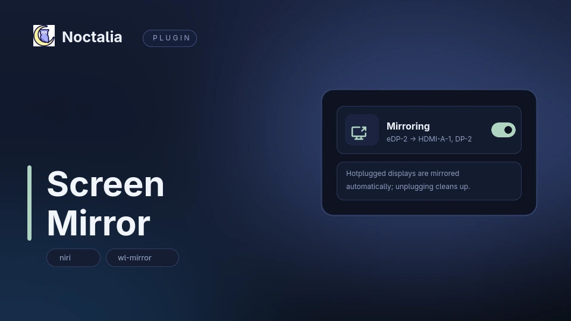

# Noctalia Screen Mirror — mirror the main niri output onto every display (Noctalia v5 plugin)

A [Noctalia](https://noctalia.dev) v5 plugin that **mirrors the main niri output onto every other
connected display**, with a control-center tile, an optional bar widget, and all the display
options in the plugin settings. Plug a monitor in and it gets a mirror; unplug it and the window is
cleaned up.

niri has no output mirroring of its own (`Mirroring is not yet supported`), so the plugin drives
the companion [`niri-mirror`](https://github.com/Goldppx/niri-mirror) daemon, which renders the
source output with [wl-mirror](https://github.com/Ferdi265/wl-mirror) and fullscreens that window
on the target display.



## Features

- **Automatic**: hotplugged displays are mirrored without polling — the daemon follows niri's
  event stream
- **Control-center tile** and optional **bar widget** with live state (`Mirror On` / `Mirror Off`)
- **Per-display exclusion list**: a display on it never gets a mirror window, even when plugged in
- **Fuzzy connector names**: `hdmi` matches `HDMI-A-1` (exact → case-insensitive → unique substring),
  and a name that matches nothing is reported back with the list of connected outputs
- **OSD feedback** on every toggle, including toggles made with a keybind
- **Scaling modes** for unlike resolutions: fit, cover, or exact integer multiples

## Requirements

| Requirement | Why |
| --- | --- |
| `niri` | Target compositor; mirroring uses its outputs and its output events. |
| `wl-mirror` | Renders the source output into a window that gets fullscreened on the target display. |
| `python3` | Runs the companion daemon that follows niri's event stream. |
| `niri-mirror CLI (~/.local/bin/niri-mirror, installed by this repo's install.sh)` | The companion daemon and CLI that do the actual mirroring. |

```sh
sudo pacman -S wl-mirror            # the only manual step
```

## Install

```sh
git clone https://github.com/Goldppx/noctalia-screen-mirror.git
cd noctalia-screen-mirror
./install.sh          # installs the engine if missing, registers the source, enables the plugin
```

`install.sh` takes care of the companion daemon too: it uses a `niri-mirror` CLI that is already
on `PATH` or in `~/.local/bin`, and otherwise clones
[niri-mirror](https://github.com/Goldppx/niri-mirror) into a temporary directory and runs its
`install.sh`, which installs the CLI and adds the daemon's niri autostart entry. `wl-mirror`
remains a normal package:

```sh
sudo pacman -S wl-mirror
```

Options: `--no-daemon` (check only, never fetch), `NIRI_MIRROR_DIR=/path/to/niri-mirror ./install.sh`
(use a local checkout), `SOURCE_NAME=my-plugins ./install.sh` (another source name).

Then add the tile under **Settings → Control center → Shortcuts → Screen Mirror**, or in
`~/.config/noctalia/config.toml`:

```toml
[[control_center.shortcuts]]
type = "goldesquemoon/screen-mirror:mirror"
```

## Usage

| Entry | Type | What it does |
| --- | --- | --- |
| `mirror` | control-center shortcut | Toggles mirroring; highlighted means on, right click re-reads the daemon. |
| `screen-mirror` | bar widget | Same state and toggle from the bar; the tooltip shows source and targets. |
| `state` | service | Bridges the settings to the daemon's `config.json` and polls its state file. |

Keybind example (niri):

```kdl
Mod+Shift+U { spawn "noctalia" "msg" "plugin" "goldesquemoon/screen-mirror:state" "all" "toggle"; }
```

List connector names before filling in the settings:

```sh
niri-mirror --list-outputs
```

## Settings

| Setting | Type | Default | Description |
| --- | --- | --- | --- |
| `enabled_on_start` | `bool` | `true` | Start the daemon with mirroring on. The off state does not survive a logout; mirroring always starts from this value. |
| `source_output` | `string` | empty | Connector to mirror from. Empty uses the focused display at startup and re-elects when it disappears. |
| `excluded_outputs` | `string_list` | empty | Connectors that never get a mirror window, even when plugged in. One per entry. |
| `scaling` | `select` | fit | How wl-mirror fits the source: `fit` (letterbox), `cover` (fill, crop), `exact` (integer multiples only). |
| `show_osd` | `bool` | `true` | OSD popup (or notification) on every toggle. |
| `poll_interval` | `int` | `2000` | How often the tile and widget re-read the daemon state file (minimum 500). |

## FAQ

**Does it work on Hyprland or Sway?** Not yet: the daemon consumes niri's event stream. `wl-mirror`
itself works on other compositors, but the hotplug handling in this plugin is niri-specific.

**Why do I need a separate daemon?** niri cannot mirror outputs itself, and a mirror has to be a
real window that follows output changes. The daemon keeps that window in place across hotplug and
workspace changes; the plugin is its UI and settings bridge.

**The tile says the plugin is not installed.** The `niri-mirror` CLI is missing from
`~/.local/bin`; run this repo's `install.sh` (it installs the engine) and re-enable the plugin.

**Can I mirror two different sources at once?** No. One source output is mirrored onto the other
displays; use the exclusion list to keep a display out of it.

**My monitor is mirrored even though I excluded it.** Exclusion matches connector names; check the
spelling with `niri-mirror --list-outputs` (partial names are accepted, case-insensitive).

## 中文说明

把 niri 主屏画面镜像到每一块新接入的外接显示器，插上自动镜像、拔掉自动清理。niri 本身没有
output mirroring，镜像由配套的 [`niri-mirror`](https://github.com/Goldppx/niri-mirror) 守护进程
用 wl-mirror 完成，本插件是它的 UI 与设置桥。

- 控制中心磁贴 / 栏挂件一键开关，OSD 反馈可在设置里关闭
- 设置项：`enabled_on_start`、`source_output`、`excluded_outputs`、`scaling`（fit/cover/exact）、
  `show_osd`、`poll_interval`
- 显示器名支持模糊匹配：`hdmi` 能匹配 `HDMI-A-1`；写错会回显真实可用列表
  （`niri-mirror --list-outputs` 可直接查看）
- 依赖：`niri`、`wl-mirror`、`python3`、`niri-mirror`

安装：

```sh
git clone https://github.com/Goldppx/niri-mirror.git && cd niri-mirror && ./install.sh
git clone https://github.com/Goldppx/noctalia-screen-mirror.git
cd noctalia-screen-mirror && ./install.sh
```

## Search terms / 关键词

Noctalia plugin, Noctalia v5, screen mirroring, output mirror, duplicate display, second monitor,
hotplug, HDMI, DisplayPort, wl-mirror, niri, niri output mirroring, Wayland, control-center tile,
bar widget, Arch Linux, CachyOS, 屏幕镜像, 显示器复制, 外接显示器, 热插拔, 投屏

## Links

- Plugin source: [`screen-mirror/`](screen-mirror/)
- Mirror engine: <https://github.com/Goldppx/niri-mirror>
- Noctalia: <https://noctalia.dev>
- Community plugin store: <https://noctalia.dev/plugins>

## License

MIT
